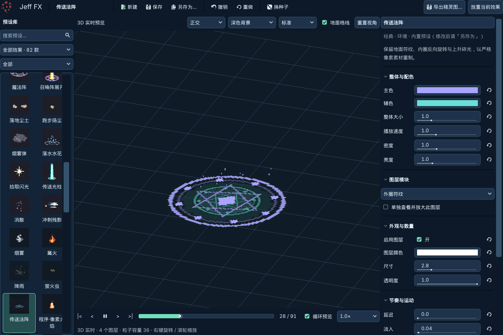

# Jeff FX · 1.0

**Godot 像素特效工坊：选择效果、调整参数、放入场景，也可以导出透明精灵图。**

免费、离线使用，藏青色界面。包含 **82 款内置效果：38 款程序像素预设 + 44 款经典三维效果**，以及一个可直接运行的纯 2D 武侠庭院测试工程。

[下载插件 ZIP](https://github.com/Smidle/Jeff-FX-forge/releases/download/v1.0/Jeff-FX-1.0-plugin.zip) · [图文用户说明书](docs/manual.md) · [庭院测试说明](docs/test-scene.md) · [版本记录](CHANGELOG.md) · [已知限制](docs/compatibility.md)



## 选择下载内容

| 你的目的 | 下载内容 | 使用方法 |
|---|---|---|
| 给自己的 Godot 工程安装插件 | Release 中的 **Jeff-FX-1.0-plugin.zip** | 解压，把 `addons/fx_forge` 复制到自己的工程 |
| 体验庭院、查看技能绑定示例 | 本仓库 **Code → Download ZIP** 或 `git clone` | 导入根目录 `project.godot`，等待资源导入后按 **F5** |

**专用插件 ZIP 不包含测试场景、角色、字体、游戏脚本或开发产物。** GitHub 自动提供的 “Source code (zip/tar.gz)” 是整个仓库源码，因此包含测试工程；只安装插件时请选择上表中的专用附件。

本次按维护者要求把版本编号统一为 **1.0**。历史 `v1.0.1` 保留，当前版本以本页及 `v1.0` Release 为准。

## 五分钟开始制作

1. 使用 **Godot 4.7**；本版本实测 **4.7.2 / macOS / Apple M4 / Compatibility**。
2. 复制插件后，在 **项目 → 项目设置 → 插件** 中启用 **Jeff FX**。
3. 点击编辑器顶部 **Jeff FX**，左侧选择“像素工坊 → 火焰斩”。
4. 右侧调整配色、尺寸和图层；使用下方时间轴暂停、逐帧检查。
5. 点击 **另存为…** 保存个人配方；随后 **导出精灵图…** 或 **放置当前效果**。

安装、保存、两类导出、场景放置和脚本调用的逐步截图见 [用户说明书](docs/manual.md)。

## 两类效果库

| 能力 | 像素工坊 · 38 款 | 经典效果库 · 44 款 |
|---|---|---|
| 内容 | 刀光、打击、爆炸、法阵、状态、环境 | 环境、武侠、仙侠、魔法 |
| 制作方式 | 代码逐像素生成，可组合模块图层 | 程序、粒子、像素序列帧与网格组合 |
| 编辑 | 画布、帧数、方向、色板、图层 | 配色、大小、速度、密度、空间及图层 |
| 预览 | 时间轴、逐帧、锚点与参考图 | 正交/透视、旋转视角、标准/精简档 |
| 直接放置 | Node2D 或 Node3D 场景 | Node3D 场景 |
| 导出 | PNG、JSON、SpriteFrames、即用场景、序列、GIF | 从三维镜头录制后导出相同格式 |

两类均支持个人预设和撤销重做。**配方不是技能**：保存参数不自动绑定按键或伤害。插件不修改宿主项目的相机、分辨率或输入设置；技能逻辑放在附带的游戏示例中。

## 庭院实测


主角“姐夫”可以四向移动、两段普攻、轻功和蓄力。两个固定靶不移动、不攻击、不死亡；受击有动作与闪白。左靶在 J 命中时播放重击，右靶播放暴击，石头播放格挡火花。

| 操作 | 行为 |
|---|---|
| WASD / 方向键 | 四向移动，后按方向优先 |
| J / 空格 / 按住 K | 两段普攻 / 轻功 / 蓄力 |
| 1–4 | 虚空涡流、引雷符、回春诀、金钟罩 |
| 5–0 | 增益光环、小型爆炸、毒气爆炸、冰晶落击、岩晶突刺、寒晶牢笼 |
| Tab / E | 切换目标 / 恢复生命 |
| Esc / F9 | 按键查询与重置菜单 / 82 款效果浏览 |

十个技能冷却均为 **0.5 秒**，仍需等待当前动作收招。技能图标可点击释放。轻功使用“疾步残风＋轻功踩踏”，原库特效保持不变。引雷符在落雷接触帧结算；其他技能不会额外叠加 J 的受击、重击或暴击效果。

F9 可以手动查看全部 82 款；**手动浏览不代表 82 款均已接入游戏事件**。测试工程使用插件导出的二维帧及独立的场景参数，详见 [场景说明与效果对应表](docs/test-scene.md)。

## 文件与更新

```text
addons/fx_forge/          插件本体（Release ZIP 仅此目录）
project.godot            庭院测试工程入口
scenes/moon_temple/      当前庭院布局与主场景
scripts/                游戏控制、技能、HUD、效果播放
assets/                 测试角色、庭院、图标、字体与导出效果
data/                  技能参数、动画标记、效果目录与场景变体
docs/                  图文说明、截图与验证摘要
```

`fx_forge_presets/` 是你保存的个人配方，`fx_exports/` 是默认导出位置；两者按需生成，不随版本上传。升级前备份工程及个人文件，停用插件，完整替换 `addons/fx_forge/` 后重新启用。

## 兼容性与许可

本版验证环境为 Godot 4.7.2、macOS、Apple M4、Compatibility。Windows、Linux、Forward+、Mobile 与手机性能未做本版实机验收。三维录制输出为二维动画，持续效果不保证无缝循环；部分爆炸与烟雾有末帧截断。见 [已知限制](docs/compatibility.md) 和 [发布验证](docs/verification.md)。

代码与文档采用 **MIT**；插件原创美术采用 **CC0 1.0**。庭院包含经维护者确认获得公开再分发授权的第三方角色/头像，以及按 OFL 1.1 提供的 GNU Unifont，**它们不属于插件的 MIT／CC0 素材许可**。详见 [NOTICE](NOTICE.md)。

**English:** Jeff FX 1.0 is a free, offline Godot 4.7 VFX editor with 38 procedural pixel presets and 44 classic 3D effects. The repository includes a runnable 2D courtyard demo; the dedicated Release ZIP contains only `addons/fx_forge`. Enable the plugin under Project Settings → Plugins, or import the repository's `project.godot` and press F5 to try the demo. See the illustrated Chinese manual and asset-specific notices before reusing demo content.
