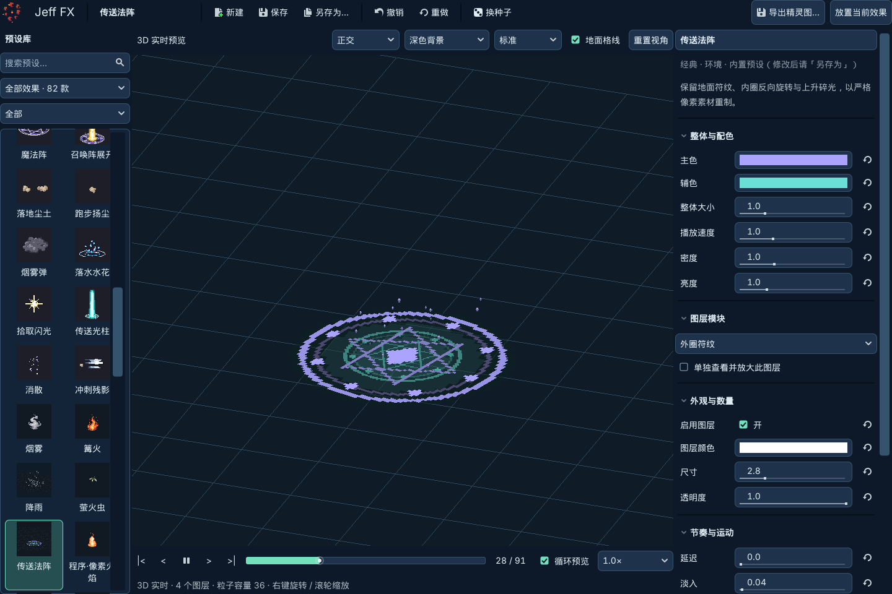
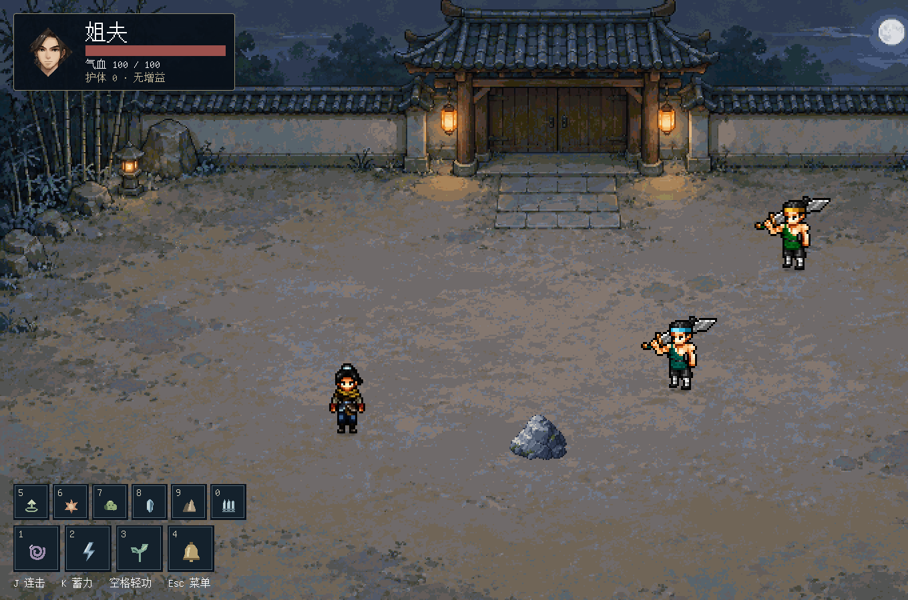
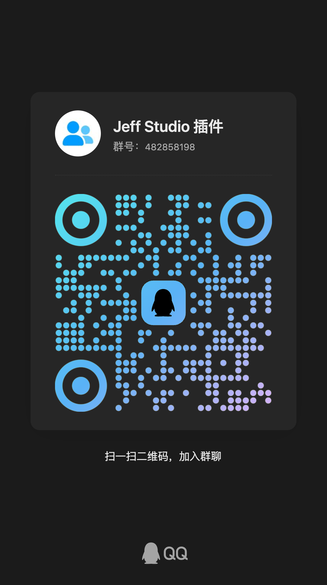

# Jeff FX · 1.1

**Godot 像素特效工坊：选择效果、调整参数、放入场景，也可以导出透明精灵图。**

免费、离线使用，藏青色界面。包含 **129 款内置效果：像素工坊 63 款 + 三维效果库 66 款**，以及四个可直接运行的测试场景：纯 2D 武侠庭院、3D 分类试验场、等距测试场、夏日花火大会。

[下载插件 ZIP](https://github.com/Smidle/Jeff-FX-forge/releases/download/v1.1/Jeff-FX-1.1-plugin.zip) · [图文用户说明书](docs/manual.md) · [特效库说明](docs/multistyle-library.md) · [追踪飞弹](docs/missiles.md) · [庭院测试说明](docs/test-scene.md) · [版本记录](CHANGELOG.md) · [已知限制](docs/compatibility.md)



## 选择下载内容

| 你的目的 | 下载内容 | 使用方法 |
|---|---|---|
| 给自己的 Godot 工程安装插件 | Release 中的 **Jeff-FX-1.1-plugin.zip** | 解压，把 `addons/fx_forge` 复制到自己的工程 |
| 体验测试场景、查看技能绑定示例 | 本仓库 **Code → Download ZIP** 或 `git clone` | 导入根目录 `project.godot`，等待资源导入后按 **F5** |

**专用插件 ZIP 不包含测试场景、角色、字体、游戏脚本或开发产物。** GitHub 自动提供的 “Source code (zip/tar.gz)” 是整个仓库源码，因此包含测试工程；只安装插件时请选择上表中的专用附件。

## 1.1 新增

- **效果库扩展到 129 款**：三维效果库新增 18 款多风格效果（细腻像素、复古像素、手绘、卡通、水墨、自然写实），预设库可以按来源、用途和「系」筛选。
- **pixelfx 升级版 25 款**：参照 [pixelfx](https://github.com/patch-gg/pixelfx)（MIT）的制作方法新做的像素特效：5 款升级版、16 款按绽放方式命名的烟花（包括排出一行字的「文字绽放」）、4 款飞弹命中。
- **追踪飞弹 4 款**：御剑流光、火球术、寒冰箭、暗影箭。在预览里拖动起终点、编辑自定义曲线，模拟移动目标；带弹头光晕、拖尾粒子、残影和像素命中。
- **工坊 3D 场景**：像素特效可以放进三维世界预览，旁边有程序生成的参考角色；飞弹预览的终点有稻草人，被打中会摇晃、闪白、按元素染色。
- **像素引擎新能力**：叠加光、真正半透明的烟、尾迹、分裂、球形炸开、发射点上升、图案和文字发射、闪烁频率、开始淡出等。全部默认关闭，原有 38 款像素效果逐帧不变。
- **三个新测试场景**：3D 分类试验场、等距测试场、夏日花火大会；在任意测试场景按 Esc 切换。

从 1.0.1 升级：保存工作，停用插件，完整替换 `addons/fx_forge/` 后重新启用。个人配方（`fx_forge_presets/`）和导出文件不受影响。完整列表见 [版本记录](CHANGELOG.md)。

## 五分钟开始制作

1. 使用 **Godot 4.7**；本版本实测 **4.7.2 / macOS / Apple M4 / Compatibility**。
2. 复制插件后，在 **项目 → 项目设置 → 插件** 中启用 **Jeff FX**。
3. 点击编辑器顶部 **Jeff FX**，左侧选择“像素工坊 → 火焰斩”。
4. 右侧调整配色、尺寸和图层；使用下方时间轴暂停、逐帧检查。
5. 点击 **另存为…** 保存个人配方；随后 **导出精灵图…** 或 **放置当前效果**。

安装、保存、两类导出、场景放置和脚本调用的逐步截图见 [用户说明书](docs/manual.md)。

## 两类效果库

| 能力 | 像素工坊 · 63 款 | 三维效果库 · 66 款 |
|---|---|---|
| 内容 | 刀光、打击、爆炸、法阵、状态、环境、烟花、飞弹命中 | 环境、武侠、仙侠、魔法、多风格扩展、追踪飞弹 |
| 制作方式 | 代码逐像素生成，可组合模块图层 | 程序、粒子、像素序列帧与网格组合 |
| 编辑 | 画布、帧数、方向、色板、图层 | 配色、大小、速度、密度、空间及图层 |
| 预览 | 时间轴、逐帧、锚点与参考图、3D 场景与参考角色 | 正交/透视、旋转视角、标准/精简档、飞弹路径编辑与稻草人 |
| 直接放置 | Node2D 或 Node3D 场景 | Node3D 场景 |
| 导出 | PNG、JSON、SpriteFrames、即用场景、序列、GIF | 从三维镜头录制后导出相同格式 |

两类均支持个人预设和撤销重做。**配方不是技能**：保存参数不自动绑定按键或伤害。插件不修改宿主项目的相机、分辨率或输入设置；技能逻辑放在附带的游戏示例中。

## 庭院实测



主角“姐夫”可以四向移动、两段普攻、轻功和蓄力。两个固定靶不移动、不攻击、不死亡；受击有动作与闪白。左靶在 J 命中时播放重击，右靶播放暴击，石头播放格挡火花。

| 操作 | 行为 |
|---|---|
| WASD / 方向键 | 四向移动，后按方向优先 |
| J / 空格 / 按住 K | 两段普攻 / 轻功 / 蓄力 |
| 1–4 | 虚空涡流、引雷符、回春诀、金钟罩 |
| 5–0 | 增益光环、小型爆炸、毒气爆炸、冰晶落击、岩晶突刺、寒晶牢笼 |
| Tab / E | 切换目标 / 恢复生命 |
| Esc / F9 | 按键查询与重置菜单 / 82 款效果浏览 |

十个技能冷却均为 **0.5 秒**，仍需等待当前动作收招。技能图标可点击释放。轻功使用“疾步残风＋轻功踩踏”，原库特效保持不变。引雷符在落雷接触帧结算；其他技能不会额外叠加 J 的受击、重击或暴击效果。

F9 可以手动查看庭院收录的 82 款（1.0 时的原库）；**手动浏览不代表 82 款均已接入游戏事件**。1.1 新增的效果在工坊和下面的其他测试场景里查看。测试工程使用插件导出的二维帧及独立的场景参数，详见 [场景说明与效果对应表](docs/test-scene.md)。

## 其他测试场景

| 场景 | 打开方式 | 用来做什么 |
|---|---|---|
| 3D 分类试验场 | 打开 `scenes/fx_library_lab.tscn`，按 **F6** | 三维效果按用途分组试放，检查尺寸、运动、跟随与遮挡。说明见 [3D 分类试验场](docs/library-lab.md) |
| 等距测试场 | 打开 `scenes/iso_lab.tscn`，按 **F6** | 斜俯视的 HD-2D 镜头里移动角色、绑定技能，追踪飞弹打木桩。说明见 [等距测试场](docs/iso-lab.md) |
| 夏日花火大会 | 打开 `scenes/festival.tscn`，按 **F6**；或在等距测试场走进「花火之门」 | 夜晚的海港，按「放烟花」看一场烟花大会，最后一发在天上排出「Jeff Studio」。说明见 [夏日花火大会](docs/festival.md) |

在任意测试场景按 **Esc** 可以切换场景。等距测试场的废墟营地和夏日花火大会的人物、远景用的是第三方游戏素材，只在维护者本机测试，**仓库里不包含**（见 [NOTICE](NOTICE.md)）。没有这些素材时两个场景照常运行：等距测试场只有地面、角色和特效，花火大会只有夜空、灯笼和烟花。

## 文件与更新

```text
addons/fx_forge/          插件本体（Release ZIP 仅此目录）
project.godot            测试工程入口（F5 是庭院）
scenes/moon_temple/      当前庭院布局与主场景
scenes/*.tscn            3D 分类试验场、等距测试场、夏日花火大会
scripts/                游戏控制、技能、HUD、效果播放
assets/                 测试角色、庭院、图标、字体与导出效果
data/                  技能参数、动画标记、效果目录与场景变体
docs/                  图文说明、截图与验证摘要
```

`fx_forge_presets/` 是你保存的个人配方，`fx_exports/` 是默认导出位置；两者按需生成，不随版本上传。升级前备份工程及个人文件，停用插件，完整替换 `addons/fx_forge/` 后重新启用。

## 兼容性与许可

本版验证环境为 Godot 4.7.2、macOS、Apple M4、Compatibility。Windows、Linux、Forward+、Mobile 与手机性能未做本版实机验收。三维录制输出为二维动画，持续效果不保证无缝循环；部分爆炸与烟雾有末帧截断。见 [已知限制](docs/compatibility.md) 和 [发布验证](docs/verification.md)。

代码与文档采用 **MIT**；插件原创美术采用 **CC0 1.0**。庭院包含经维护者确认获得公开再分发授权的第三方角色/头像，以及按 OFL 1.1 提供的 GNU Unifont，**它们不属于插件的 MIT／CC0 素材许可**。详见 [NOTICE](NOTICE.md)。

**English:** Jeff FX 1.1 is a free, offline Godot 4.7 VFX editor with 129 built-in effects: 63 procedural pixel presets (including fireworks and missile hits made with the pixelfx approach) and 66 3D effects (including 18 multi-style effects and 4 homing missiles with an editable flight path). The workshop can preview pixel effects in a 3D scene next to a reference character. The repository includes four runnable test scenes (2D courtyard, 3D library lab, isometric lab, summer fireworks festival); the dedicated Release ZIP contains only `addons/fx_forge`. Enable the plugin under Project Settings → Plugins, or import the repository's `project.godot` and press F5 to try the demo. See the illustrated Chinese manual and asset-specific notices before reusing demo content.

## 交流与反馈

欢迎交流使用方法、分享特效作品和反馈问题。点击图片可查看原图。

| 微信群 · Jeff Studio 内测群 | QQ 群 · Jeff Studio 插件 |
|---|---|
| 使用微信扫描下方二维码入群。 | 在 QQ 中搜索群号 **482858198**，或扫描下方二维码入群。 |
| <a href="docs/community/wechat-group.png"></a> | <a href="docs/community/qq-group.png"></a> |

微信图片标注二维码在 **2026 年 11 月 4 日前有效**；若扫码失效，可先通过 QQ 群联系获取新的入群方式。
