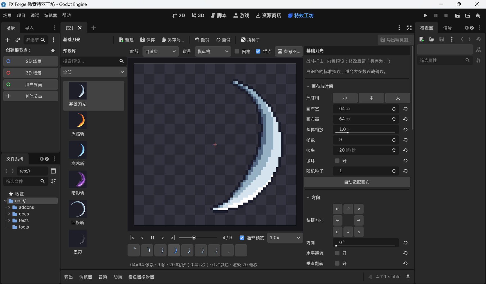
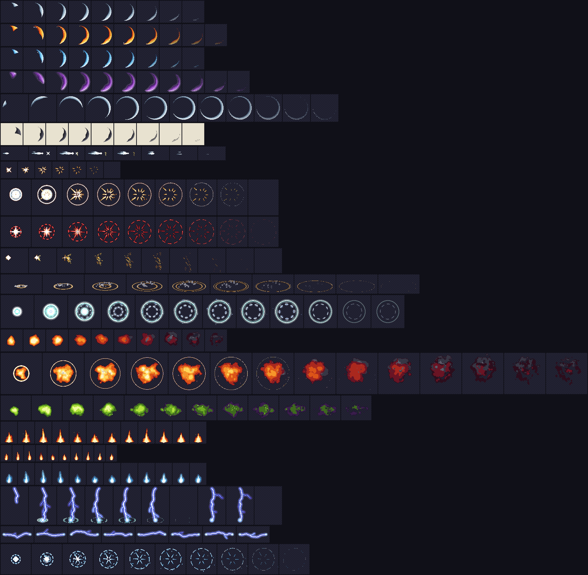
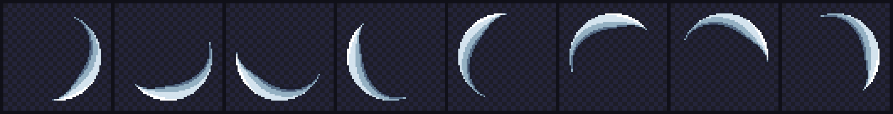

# FX Forge 像素特效工坊

Godot 4.7 编辑器插件：挑一个像素特效预设，拖滑条调宽度、描边、方向、配色，一键导出**精灵图**和**能直接拖进游戏的场景**。

**完整的中文使用手册：[docs/manual.md](docs/manual.md)** · 1.0 测试清单：[docs/test-checklist.md](docs/test-checklist.md)



内置预设效果（每行一个预设，从左到右是动画的每一帧）：



同一个刀光的 8 个方向（任何角度都是干净的像素线条）：



## 当前版本：1.0

- 特效模块 11 个：**弧光**（斩击、回旋斩）、**射线爆发**（打击火花、星形闪光）、**环**（冲击波、能量环、护盾）、
  **粒子**（火星、碎屑、尘土烟团、水滴、治疗十字；可以向外飞散或向中心汇聚、左右对称、摇摆飘动、落地消失）、**冲刺线**（突刺、速度线）、
  **能量团**（爆炸火球、烟团、毒雾）、**火焰**（篝火、火把，可无缝循环）、**闪电**（落雷、电弧、放射闪电）、
  **能量弹**（火球弹、魔法飞弹）、**法阵**（魔法阵、召唤阵，可以逐笔画出）、**光柱**（传送光柱、激光、圣光）
- 内置预设 38 个：
  - 刀光：基础刀光、火焰斩（带火星）、寒冰斩（带冰屑）、暗影斩、回旋斩、墨刃（水墨风，适合武侠题材）
  - 打击：突刺、普通打击、重击、暴击、格挡火花、地面冲击波、能量冲击环
  - 爆炸与元素：小型爆炸、大型爆炸、毒气爆炸、落雷、冰晶爆裂；循环播放的篝火、火把、蓝焰、电弧
  - 魔法与状态：治疗、召唤阵展开；循环播放的火球弹、魔法飞弹、增益光环、护盾、蓄力、魔法阵
  - 环境与通用：落地尘土、跑步扬尘、烟雾弹、落水水花、拾取闪光、传送光柱、消散、冲刺残影
- 一个特效可以由多个**图层**叠成：右边面板的「图层」区可以添加、复制、上下移动、隐藏、删除、改名；
  每个图层还可以有自己的「消散方式」（例如烟雾用收缩、火球用抖动溶解）
- **打击停顿**：让命中的那一帧多停一会儿，导出的动画、JSON、GIF 都带上停顿（重击、暴击默认开启）
- **色板编辑器**：逐个改颜色、用一个颜色生成色阶、导入 Lospec .hex / GIMP .gpl / 调色板图片
- **GIF 动图导出**：预览、分享用，可选透明 / 深色 / 浅色底
- **预设库右键菜单**：重命名、复制、删除（进回收站）、在文件系统中显示；内置预设一键复制成「我的预设」
- 界面文字全部集中经过翻译函数，以后可以加英文界面

## 快速开始

1. 用 Godot 4.7 打开本工程（双击 `project.godot`，或在项目管理器里导入这个文件夹）。
2. 点编辑器顶部的 **「特效工坊」** 标签（和 2D、3D、脚本并列）。
3. 左边点一个预设，中间会循环播放；右边拖滑条调参数，预览实时刷新。
4. 点右上角 **「导出精灵图…」**，再点「导出」。文件默认放在 `res://fx_exports/`。
5. 按 **F5** 运行演示场景：鼠标左键点哪里，特效就在哪里播放（滚轮切换特效）。

## 在你自己的游戏里使用

**方式一：只拿导出结果（最简单）**
把 `fx_exports/` 里同名的三个文件复制到你的项目（建议也放在 `res://fx_exports/` 目录下）：
`xxx.png`（精灵图）、`xxx_frames.tres`（动画资源）、`xxx.tscn`（即用场景）。然后：

```gdscript
var fx = preload("res://fx_exports/slash_fire.tscn").instantiate()
fx.position = hit_position      # 特效原点放在哪里
add_child(fx)                   # 一次性特效播完会自动消失
```

在场景的检查器里还能勾选「随机左右镜像」；想让特效朝左，把节点的 `scale.x` 设成 -1 即可。
循环特效（篝火、火把、火球弹、护盾、魔法阵……）不会自动消失，会一直播放到你删除它（`fx.queue_free()`）。

**方式二：把插件装进你的项目**
把 `addons/fx_forge` 整个文件夹复制到你项目的 `addons/` 下，打开「项目 → 项目设置 → 插件」，启用「FX Forge 像素特效工坊」。

## 常用参数

| 分组 | 参数 | 说明 |
|---|---|---|
| 画布与时间 | 尺寸档 小/中/大 | 一键把特效整体缩小一半 / 原样 / 放大一倍 |
| | 帧数、帧率 | 帧数 ÷ 帧率 = 动画时长 |
| | 打击停顿帧、停顿倍数 | 让第几帧多停几倍时间（命中瞬间停一下，打击感更强） |
| | 随机种子 | 换个数字就是同一特效的另一种随机变化（工具栏「换种子」也行） |
| 方向 | 八方向按钮、方向角 | 0° 朝右，90° 朝下 |
| 外观 | 配色主题 | 火焰、冰霜、雷电、毒素、神圣、暗影、水墨、尘土、烟雾……一键换色 |
| | 色板 ✎ 编辑 | 改颜色、用一个颜色生成色阶、导入 Lospec / GIMP 色板文件 |
| | 柔光强度 | 0 = 纯硬边像素；调高后外圈有半透明发光 |
| | 色阶抖动、消散方式 | 像素画常用的点阵过渡；特效变淡时是点阵溶解、收缩、变暗还是淡出 |
| 描边 | 外 / 内 / 选择性描边 | 选择性描边：描边颜色跟着旁边像素自动加深 |
| 弧光 | 半径、宽度、弧度 | 刀光大小、粗细、扫过的角度（360° 就是回旋斩） |
| | 尖锐度、月牙感、拖尾长度、残影数 | 刀光的形状和节奏 |
| 射线爆发 | 射线数、长度、宽度、扩散角 | 扩散角小于 360° 时只朝「方向」喷（格挡、定向打击） |
| | 中心闪光、脱离中心 | 开头的星形 / 圆形闪光；射线根部飞离中心的程度 |
| 环 | 最大半径、环宽、越扩越细 | 冲击波的大小和粗细变化 |
| | 地面透视、分段数、环数 | 压扁成地面上的椭圆；切成旋转的虚线；几道环先后扩散 |
| | 冲击闪光、模式 | 开头的实心闪光；扩散 / 收缩 / 呼吸脉动 / 静止（护盾） |
| 粒子 | 数量、形状、大小 | 点、方块、圆点、十字、菱形、四角星、拖影线、碎片、烟团（上亮下暗的圆团，做尘土和烟） |
| | 发射区域、扩散角、速度、重力、阻力、寿命 | 从哪里冒出来、往哪飞、飞多远、往下掉还是往上飘 |
| | 运动方式 | 向外飞散 / 向中心汇聚（蓄力时光点被吸进来） |
| | 左右对称、左右摆动、落地消失 | 一半粒子往另一侧飞（落地尘土）；飘的时候左右摇（灰烬、消散）；掉到地面线以下就消失（水花） |
| 冲刺线 | 条数、长度、宽度、前冲距离 | 突刺的锋芒和两侧的速度线 |
| 能量团 | 团数、半径、散开范围、翻滚强度 | 几个团块融合成的火球 / 烟团，边缘翻滚 |
| | 初始热度、冷却、烧穿消散、上升距离 | 从白热变暗红；后半段烧出窟窿碎开；烟往上飘 |
| 火焰 | 宽度、高度、底部形状、火舌数 | 平底篝火、尖底火苗、圆团鬼火；横向分几条火舌 |
| | 上升速度、摇曳、湍流、倾斜 | 火舌窜动的快慢、左右摆动、边缘的碎、被风吹歪 |
| 闪电 | 模式、长度、锯齿幅度、分支数 | 落雷 / 电弧 / 放射；折线有多曲折、分几个叉 |
| | 闪烁次数、点亮比例、光晕宽度 | 闪几下（每下换形状）、每下亮多久、外面的光晕 |
| 能量弹 | 弹体形状、核心半径、光晕半径 | 圆球 / 菱形 / 边缘翻滚的火球；芯和整体有多大 |
| | 拖尾长度、粗细、波动、尾巴流动 | 往飞行反方向拖出的尾巴；尾巴上的明暗条往后流 |
| | 环绕光点、环绕半径、环绕圈数 | 绕着弹体转的小光点（魔法飞弹） |
| 法阵 | 外环半径、环数、星形顶点、星形跳点 | 6 顶点跳 2 = 六芒星，5 顶点跳 2 = 五芒星，跳 1 = 正多边形 |
| | 刻度数、地面透视、旋转圈数、内圈反转 | 环上的刻度；压扁贴地；转几圈（循环要整数圈） |
| | 逐笔画出、结尾淡出、顶点符文 | 外环 → 内环 → 星形 → 刻度依次画出来；最后溶解消失 |
| 光柱 | 长度、宽度、内核宽度、末端收窄 | 方向设 270° 就是朝上的光柱 |
| | 展开用时、收起用时、边缘波纹、亮条、底部光斑 | 从细线展开、最后收成一条线；边缘和内部沿光柱流动 |

每个参数旁边的 ↺ 按钮可以恢复默认值；鼠标停在参数名上会显示中文说明。只和当前设置有关的参数才会显示（比如没开描边时不显示描边颜色）。勾选面板底部的「显示高级参数」可以看到更多选项（原点位置、透明度层级等）。

**图层**：特效由若干图层叠成，列表上面的图层盖住下面的。点「添加图层」选一种模块；每行右边的按钮可以上移、下移、复制、删除，左边的眼睛可以临时隐藏。新加的粒子图层默认用「辅色板」，所以火星、碎屑会和主体颜色区分开。

## 导出的文件

| 文件 | 用途 |
|---|---|
| `xxx.png` | 精灵图（所有帧拼在一张图上） |
| `xxx_frames.tres` | Godot 的 SpriteFrames 动画资源，帧率和循环都设好了 |
| `xxx.tscn` | 即用场景：自动播放，一次性特效播完自动删除；不依赖插件，删掉插件也能用 |
| `xxx.json` | Aseprite 格式的帧数据（其他引擎和工具能读），附带锚点、帧率 |
| `xxx_seq/`（可选） | 单帧 PNG 序列，可以在 Aseprite 里打开继续手工修改 |
| `xxx.fxforge.tres` | 这次导出用的预设副本：以后双击它就能回到特效工坊继续改 |
| `xxx.gif`（可选） | GIF 动图，预览、发给别人看（单独的放大倍数和背景色） |

导出对话框还支持：4 方向 / 8 方向 / 左右镜像批量导出（每个方向一行）、多个随机变体、放大 2~4 倍（分享用）、裁掉空白、发光叠加混合模式。

## 小技巧

- **参考图**：预览区上方点「参考图…」，放一张你的角色图片在特效后面对比大小（右键拖动移动它）。
- **超出画布**：状态栏出现「⚠ 特效超出画布」时，点「自动适配画布」。
- **内置预设是只读的**：改完点「另存为…」存成「我的预设」（保存在 `res://fx_forge_presets/`）。
- **右键点预设缩略图**：重命名、复制、删除「我的预设」；内置预设可以「复制为我的预设」。
- **撤销**：Ctrl+Z / 工具栏「撤销」。
- **预览快捷键**：空格 播放/暂停，← → 逐帧；滚轮缩放，中键拖动平移，双击恢复视图。
- 改了参数再导出同名文件，游戏里引用它的地方会自动用上新效果。

## 开发

给 Claude / 开发者的说明见 [CLAUDE.md](CLAUDE.md)；完整设计方案见 [docs/design.md](docs/design.md)。
