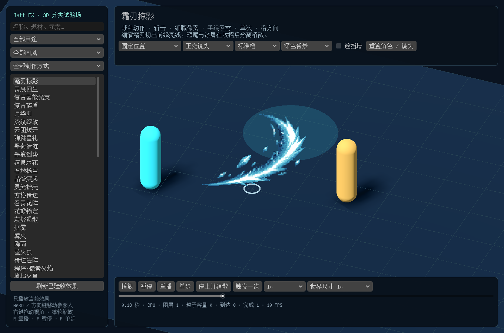

# 3D 特效试验场操作说明

试验场展示三维效果库：原有 44 款＋多风格扩展 18 款，以及 4 款追踪飞弹。像素工坊的 63 款在编辑器的工坊里查看；1.1 共 129 款。候选作品保持隐藏。

## 打开试验场

1. 在 Godot 文件系统中找到 `res://scenes/fx_library_lab.tscn`，双击打开。
2. 按 **F6** 运行当前场景。默认先展示一款已入库的新增效果。
3. 按 **F5** 运行的仍是原来的月下庭院；不需要修改项目主场景。

左侧是效果名称与用途、画风、制作方式筛选；上方是试验模式、镜头、质量和背景；下方是播放、时间与尺寸控制。场景一次只播放选中的效果，不同时模拟整个库。

## 选中一款效果

1. 输入名称搜索，例如“月华刃”或“召灵花阵”；也可组合用途、画风和制作方式。
2. 点击列表中的效果名称，查看上方说明与分类。
3. 单次效果结束后点击 **重播** 或按 **R**；持续效果使用 **停止并消散** 观察尾部。
4. 更换筛选时找不到作品，请清空搜索并恢复“全部用途／全部画风／全部制作方式”。
5. 如本地工程刚更新过库，点击 **刷新已验收效果**，重新读取已入库的条目。

18 款新增作品的用途和完整名单见 [多风格特效库使用说明](multistyle-library.md#这-18-款可以用在哪里)。灵光护壳和花瓣锁定为持续效果；其他 16 款为单次，包括灵泉回生和墨荷清涟。

## 四种试验模式

| 模式 | 怎么操作 | 重点看什么 |
|---|---|---|
| 固定位置 | 选择效果后直接播放 | 出现、峰值、消散、地面接触与世界尺寸 |
| 移动目标 | 金色目标自动绕圈 | 支持目标绑定的飞弹是否跟得上；其他效果停留在本次触发时的目标位置 |
| 进入区域触发 | WASD／方向键移动绿色参照人，走进蓝色圆区；也可点“触发一次” | 进入事件是否播放一次，离开再进入能否重新触发 |
| 跟随角色 | 移动绿色参照人 | 护壳、脚下标记等是否正确附着，世界空间的粒子残留是否符合预期 |

移动目标模式不会把普通斩击、法阵或爆炸自动改造成飞弹。选择真正支持目标绑定的原有飞弹时，才会使用追踪逻辑。

## 镜头、比例和遮挡

地面每格为 **1 米**，参照人高 **1.7 米**。效果使用世界尺寸，透视镜头下会随距离缩放。

- **右键拖动**旋转镜头，**滚轮**缩放。
- 切换 **正交镜头／透视镜头**，检查轮廓与朝向。
- 切换 **标准档／精简档**，比较容量和装饰变化。
- 切换 **深色背景／浅色背景**，检查亮色轮廓和透明边缘。
- 勾选 **遮挡墙**，从不同角度检查实体遮挡。
- 点击 **重置角色／镜头**，恢复参照位置与初始视角。

命中类效果的锚点应放在物体表面。将复古碎盾等效果放入实体中心，会被实体本身遮挡；实际接入游戏时应调整命中位置，而不是关闭深度关系。脚下标记与地面法阵则检查是否贴地、是否与地面重叠闪烁。

## 播放与快捷键

| 操作 | 功能 |
|---|---|
| 播放 | 播放或继续当前效果 |
| 暂停／P | 暂停特效时间 |
| 重播／R | 重新开始当前效果 |
| 单步／F | 推进约 1/30 秒，便于观察接触和消散 |
| 停止并消散 | 停止发射并保留配方规定的尾部 |
| 触发一次 | 在当前模式中重新触发 |
| 0.25×／0.5×／1×／2× | 调整预览速度 |
| 世界尺寸 0.5×／1×／2× | 临时比较角色与效果的大小 |
| 时间滑条 | 查看指定时刻或倒拖检查固定种子回放 |
| Esc | 暂停并打开测试场景列表，可以切换到月下庭院、等距测试场或夏日花火大会；再按 Esc 继续 |

输入搜索文字时，移动和播放快捷键不会误触。真实移动目标的回放只依据本次已记录轨迹，不能推测未来运动。

## 建议按这个顺序检查新增内容

1. **战斗方向**：选霜刃掠影、月华刃、墨痕剑势或复古蓄能光束，用固定位置和两种镜头比较出手方向。
2. **命中与范围**：选复古碎盾、炎纹绽放、云团爆开或晶脊突起，慢放出现和结束，开启遮挡墙。
3. **角色状态**：选灵泉回生、灵光护壳或花瓣锁定，使用跟随角色模式移动参照人；持续效果再测试停止尾部。
4. **环境接触**：选墨荷清涟、清泉水花或石地扬尘，用格线检查贴地位置和尺寸。
5. **交互与退场**：选弹跳星礼、方格传送、召灵花阵或灰烬退散，用进入区域触发模式检查重复触发与清理。

这些模式演示效果如何接入游戏事件，不包含伤害、治疗量、状态数值或真实传送规则。

## 将调整带回游戏

试验场中的模式、速度和预览尺寸不会写回内置配方。要保存自己的效果，请停止运行，点击编辑器顶部 **Jeff FX**，选择效果、调整参数并 **另存为**个人预设。

要直接接入三维场景，使用工坊的 **放置当前效果**，左键确认，Esc／右键取消；二维项目可将三维效果录制导出为精灵图、SpriteFrames 或即用场景。详细步骤见 [保存、放置和导出说明](multistyle-library.md)。

## 已验证范围与限制

这 18 款已在当前 **Apple M4、Godot GL Compatibility、CPU 粒子路径**下检查实际画面、参数、两镜头、两档质量、播放控制、保存重载、场景放置和连续导出。性能与循环清理报告保留具体测量条件；首批 12 款已完成采样绑定修正后的 1／3／16 实例复测，两款持续效果另有 18.25 秒连续推进与停发检查。

下方指标显示当前时间、后端、图层、粒子容量、到达／结束次数与当前窗口 FPS。它们只用于本机诊断，不等于 GPU 计时、完整游戏性能或手机认证。Forward+、Mobile、手机、Windows 和其他 GPU 仍需对应实机测试。
