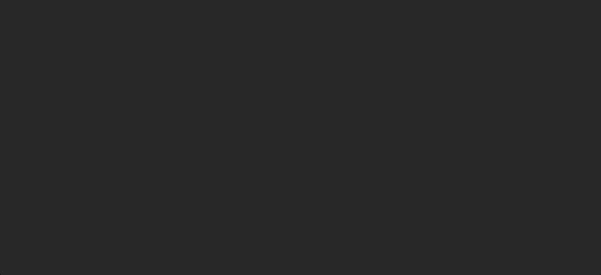
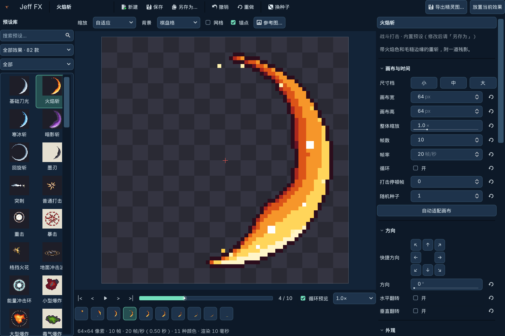
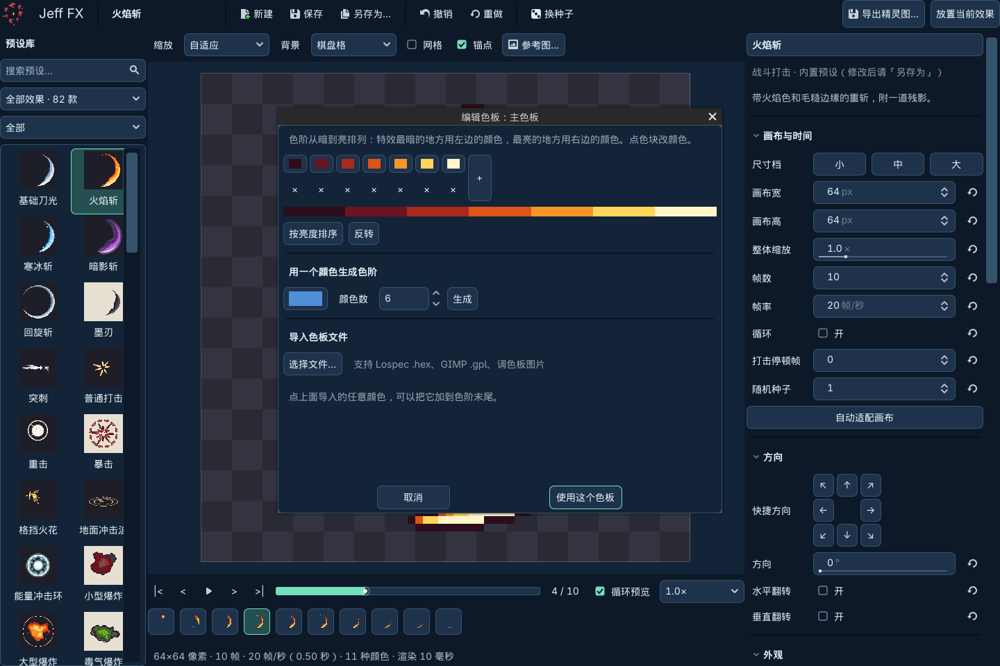
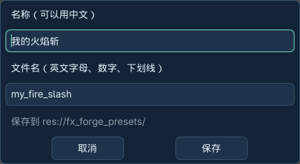
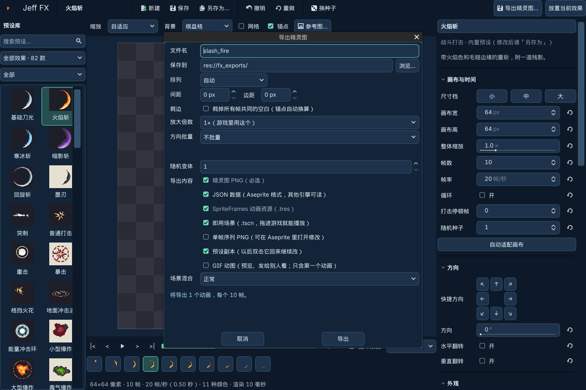
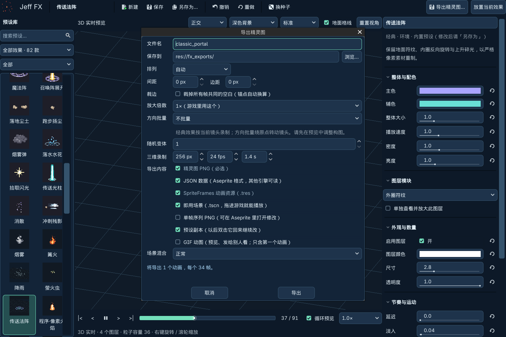
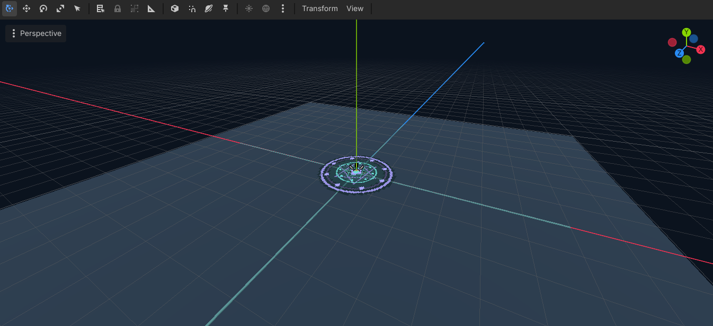

# Jeff FX 1.0.1 · 图文用户说明书

本说明面向第一次使用插件的用户。适用于 Godot 4.7；截图来自本版的实际插件界面。Godot 编辑器自身的语言、比例与停靠栏可能与你的设置不同。

[返回 README](../README.md) · [庭院测试说明](test-scene.md) · [兼容性与常见限制](compatibility.md)

## 先理解三个概念

| 名称 | 它保存了什么 | 什么时候使用 |
|---|---|---|
| 特效预设 | 颜色、尺寸、图层、随机种子等制作参数；相当于一份配方 | 想以后继续修改，或制作多个颜色版本 |
| 场景中的效果 | 具体放置的位置与效果数据 | 在游戏场景里实时播放 |
| 精灵图/动画导出 | 已生成的像素帧、播放时间和锚点 | 交给美术、其他引擎，或使用定型动画 |

**保存为预设不会绑定技能，也不会添加一个角色技能。** 左侧新出现的卡片表示新增一份可编辑配方。想覆盖已有个人预设时用“保存”；想保留原版再做变体时用“另存为”。

## 第 1 步：安装并打开

先在 Godot 创建或打开自己的工程。下载本仓库，复制 `addons/fx_forge` 到工程的 `addons/` 目录中，确认路径为 `你的工程/addons/fx_forge/plugin.cfg`，不要多套一层文件夹。

等待 Godot 导入资源，然后打开 **项目 → 项目设置 → 插件**，启用 **Jeff FX**。关闭设置，点击编辑器顶部 **Jeff FX**，看到下图工坊即安装成功。只安装插件时下载 Release 中的 `Jeff-FX-1.0.1-plugin.zip`。想运行附带的庭院测试场景，请下载仓库源码并导入根目录 `project.godot`，按 F5；详细步骤见 [庭院测试说明](test-scene.md)。



## 第 2 步：选择效果库和预设

左侧第一个下拉框选择“全部效果”“像素工坊”或“经典效果库”；第二个下拉框进一步按用途分类。输入名称或用途搜索，单击缩略图打开效果。

- **像素工坊（38 款）**：从代码生成二维像素帧，适合刀光、打击、爆炸、法阵等素材制作。
- **经典效果库（44 款）**：环境、武侠、仙侠、魔法的三维组合效果，适合场景中使用。
- 保存个人预设后总数量会增加，库中同时保留内置原版与个人版本。


## 第 3 步：检查播放节奏

使用预览下方的播放/暂停按钮、上一帧/下一帧按钮或时间进度条，检查起势、爆发与消散。像素工坊还可单击帧条跳到某一帧。

空格切换播放，左右方向键逐帧；请先让输入框失去焦点。预览速度与“循环预览”只改变观看方式；右侧配方的帧率、播放速度、循环设置才会改变效果本身。



## 第 4 步：调整像素工坊参数

在右侧先调整重要参数，再向下展开图层和高级选项。

| 参数 | 用法 |
|---|---|
| 尺寸档 | 小/中/大一起缩放效果和画布 |
| 画布宽、高 | 最终每帧图片的范围；增大画布可容纳伸出的火星与烟雾 |
| 整体缩放 | 改效果本体大小；检查是否碰到画布边缘 |
| 帧数、帧率 | 不含打击停顿时，时长约为“帧数 ÷ 帧率” |
| 循环 | 决定动画是否持续播放；任意一次性效果直接勾循环并不保证视觉自然 |
| 打击停顿 | 让命中附近的一帧多停留，增强节奏 |
| 随机种子 | 相同参数和种子便于重复比较；“换种子”生成另一种变化 |
| 方向/翻转 | 改变二维朝向；与三维 X/Y/Z 旋转不是同一个参数 |
| 配色主题、色板 | 改变主效果、装饰、烟尘的颜色阶梯 |

参数旁边的回转箭头恢复该项默认值。“撤销/重做”回退编辑。状态栏出现超出画布提示时，点“自动适配画布”并重新检查边缘。预览背景、预览缩放、参考图不会被画进导出精灵图。


## 第 5 步：修改图层与色板

向下滚动到“图层”，选择想改的部分。像素工坊可以添加、复制、删除、排序或隐藏模块图层，例如刀光主体、火星和烟雾；只改选中图层的宽度、数量、延迟等参数。

在“外观”里找到色板旁的编辑按钮。可逐个修改颜色，也可选一个基础色生成 3～8 级色阶，或导入 `.hex`、`.gpl` 和调色板 PNG。最后点击“使用这个色板”。主色板、辅色板、烟尘色板分别供不同图层使用；没有图层使用的色板不会改变画面。



## 第 6 步：编辑经典三维效果

切换到经典效果库，选择“传送法阵”作为示例。中间自动变为三维预览：右键拖动旋转视角，滚轮缩放，也可切换正交/透视、深浅背景与标准/精简档。

先改“整体与配色”中的主色、辅色、大小、速度、密度和亮度。然后在“图层模块”选择具体部分。勾选“单独查看并放大此图层”用于定位问题，结束后取消勾选以查看完整效果。

- “图层颜色”只影响当前层；“使用辅色”“跟随配色”等决定该层取色方式。
- 空间朝向决定是否面向镜头、贴地或沿运动方向。面向镜头的层受到朝向约束，不能把它当普通固定网格旋转。
- X/Y/Z 旋转针对允许旋转的层；对称图形或朝向约束可能让某个轴的变化不明显。换视角或单独查看图层确认。
- 不适用的参数会隐藏。精简档会减少装饰，不是实机性能评测结果。


## 第 7 步：保存自己的配方

点击顶部 **另存为…**。名称可以用中文，例如“我的火焰斩”；文件名使用英文字母、数字与下划线，例如 `my_fire_slash`。点击“保存”后，配方写入 `res://fx_forge_presets/`，左侧出现个人卡片。

内置预设保持原版；修改个人版本后点击“保存”更新同一个文件。标题前的圆点表示尚未保存。个人卡片右键可重命名、复制、显示文件或移到系统回收站。直接删除配方前，先检查是否有自己的场景或脚本引用它。



## 第 8 步：导出像素精灵图

选择像素工坊效果，点击右上角 **导出精灵图…**。初次建议保留默认设置：一个随机变体、1×大小，勾选 PNG、JSON、SpriteFrames 和即用场景。

| 选项 | 建议与作用 |
|---|---|
| 文件名/保存到 | 示例 `my_fire_slash`，默认目录 `res://fx_exports/` |
| 排列/列数/间距/边距 | 决定帧在整张 PNG 中如何排列 |
| 裁边 | 去除所有帧共同的空白，并同步换算锚点 |
| 放大倍数 | 游戏通常用 1×；导出 2×/4×不会增加真实细节 |
| 方向批量 | 单个、左右、4 方向或 8 方向；旋转/镜像是同一造型的不同方向 |
| 随机变体 | 用不同种子生成多份动画 |
| 单帧序列 | 希望用 Aseprite 继续修图时勾选 |
| 预设副本 | 保留这次导出所用参数，仍依赖插件继续编辑 |
| GIF | 用于预览交流；只包含第一个动画 |
| 场景混合 | 普通透明或发光叠加；暗色烟雾通常用普通透明 |

点击窗口底部“导出”，等待完成提示与 Godot 文件导入结束。窗口较小时向下滚动查看剩余选项。同名文件会提示覆盖；重新导出可更新已有引用。



**连续导出：** 完成提示出现后可继续选择其他效果并再次导出。若升级前按钮已变灰，保存工作并停用、替换、重新启用插件；1.0.1 已修复此问题，无需删除已导出的文件。

## 第 9 步：把经典效果录制成精灵图

先在经典三维预览里确定镜头角度、远近及完整构图，再点击 **导出精灵图…**。新增的“三维录制”依次设置正方形画布尺寸、录制帧率、录制时长。

从 `256 px / 24 fps` 开始，时长至少覆盖所需的完整出现与消散。先以单个方向、一个变体检查结果，再增加方向批量；经典方向批量会绕效果转动录制镜头。

录制输出带透明背景，不包含地面格线与编辑辅助线。改变预览深浅背景不改变透明输出。导出结果是二维帧；需要运行时旋转观看原来的三维结构，请使用下一步的场景放置。

持续烟雾、火焰、降雨的固定时长录制**不保证首尾无缝**。选择循环播放只改变播放方式，仍应检查接缝。



## 第 10 步：直接放进场景

先打开目标场景；像素效果支持 **Node2D 或 Node3D 根节点**，经典效果需要 **Node3D 根节点**。

回到工坊，点击 **放置当前效果**。编辑器切回 2D/3D 视图，移动鼠标查看临时预览，左键确认位置。按 **Esc 或右键**取消，取消时不会保存临时效果。确认后可用 Godot 的移动、旋转与缩放工具微调，也可撤销。

三维放置使用世界 **Y=0 平面**，不会自动贴合斜坡、墙面或其他碰撞地形；确认后手动调整高度。示例截图中的地面属于演示工作区，插件不会替你的工程创建地面或灯光。

保存场景，按 **F6** 运行。三维场景需要你自己的 Camera3D；放置的效果在游戏中自动播放。一次性效果默认结束后释放，持续效果继续运行。



## 第 11 步：使用导出文件

在 Godot 文件系统中找到导出目录。可将 `.tscn` 拖入自己的 **二维场景**，保存后按 F6 测试；或通过代码在需要时创建它。即使输入是经典三维效果，录制导出的即用场景仍是二维动画。

| 文件 | 使用方式 |
|---|---|
| `name.png` | 精灵图原图，必须保留透明度 |
| `name_frames.tres` | SpriteFrames，已含帧率、循环与帧时长 |
| `name.tscn` | 可直接播放的二维场景，保留它引用的 PNG / SpriteFrames |
| `name.json` | Aseprite 数组格式的帧信息与时间数据 |
| `name_seq/` | 单帧 PNG 序列，可交给美术继续编辑 |
| `name.gif` | 预览文件；GIF 不支持连续半透明，透明柔光会有点阵表现 |
| `name.fxforge.tres` | 配方副本，双击可回工坊继续编辑，依赖插件 |


在二维场景脚本中生成导出效果的最小示例：

```gdscript
const HIT_FX = preload("res://fx_exports/my_fire_slash.tscn")

func show_hit(world_position: Vector2) -> void:
    var fx = HIT_FX.instantiate()
    add_child(fx)
    fx.global_position = world_position
```

先添加节点再赋世界坐标，避免父节点有位移时位置计算错误。非循环即用场景播完自动删除；循环效果需要你在适当时机 `queue_free()`。多方向动画可用 `play("left")` 等动画名称切换，名称以导出的 SpriteFrames 为准。

直接放置的像素节点使用插件脚本与内嵌动画；直接放置的经典节点使用插件三维运行模块。**不要在仍引用它们时移除插件。** 想脱离插件使用，请导出即用二维场景，并保留导出目录中的依赖文件。

## 第 12 步：升级、迁移与备份

关闭正在编辑的工坊，保存工程和个人预设。备份 `fx_forge_presets/`、`fx_exports/` 及你的游戏场景；停用插件，完整替换 `addons/fx_forge/`，导入完成后重新启用。

迁移个人配方到其他工程时，需要同时安装相应版本插件。迁移导出场景时，复制 PNG、SpriteFrames 和场景文件，尽量保持路径一致。不要只复制 `.tscn` 而遗漏图片。


## 常见问题

**启用后没有入口或出现脚本错误？** 确认 Godot 版本和安装层级，等待导入完成，查看输出中的第一条脚本错误。4.0～4.6 不在本版支持范围内。

**为什么保存后多出一张卡片？** “另存为”创建新配方，保留内置原版；“保存”更新当前个人配方。卡片不是角色技能。

**为什么改辅色没有变化？** 先检查有没有启用图层使用辅色。像素工坊检查图层色板槽；经典库检查使用辅色、跟随配色和图层颜色。并非每种图层都接受同样的调色方式。

**为什么换缩放后导出大小没变？** 中央“缩放”只影响预览；右侧整体缩放/画布和导出放大倍数才改变最终文件。

**为什么播放到最后突然消失？** 一次性动画结束会移除节点；如果最后一帧仍有较大图形，就会出现截断。当前部分预设存在此问题，见兼容性说明。增加帧数本身不保证修复消散造型。

**能直接给角色绑定技能、按键或伤害吗？** 插件本身不提供角色技能编辑器。仓库中的庭院工程给出了按键、动作释放标记、命中与特效播放的完整示例；参见 [测试场景和技能配置](test-scene.md)。自己的游戏仍由角色脚本监听输入、执行战斗判定。

**可以拿去商用吗？** 代码按 MIT 使用并保留版权许可；所附原创贴图按 CC0 提供。你自己导入的参考图或第三方素材，仍需遵守各自许可。详见仓库 NOTICE。

**卡顿怎么办？** 先减少同时存在的实时效果与粒子，经典库切精简档；不需要真实三维变化时优先使用烘焙精灵图。不要把编辑器预览耗时当作手机帧率结论。

完整边界见 [兼容性与已知限制](compatibility.md)。
