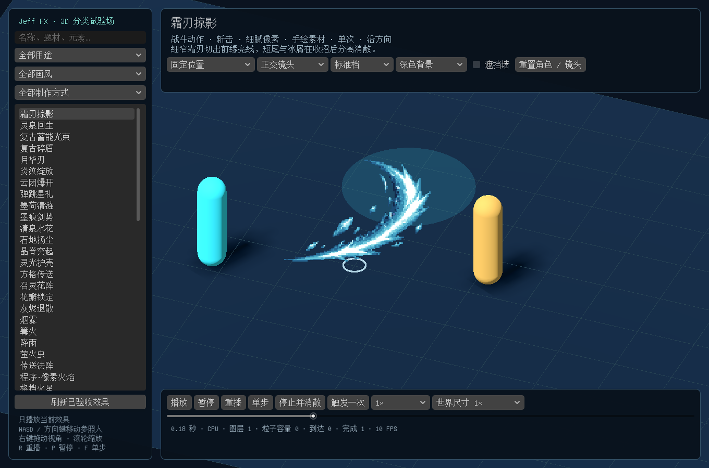
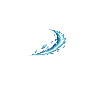
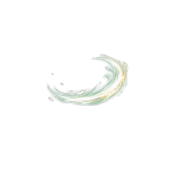
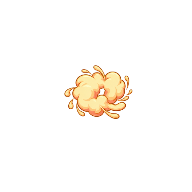
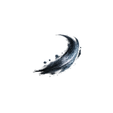
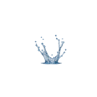

# Jeff FX 多风格特效库使用说明

**1.1 共 129 款：像素工坊 63 款（原有 38 款 + pixelfx 升级版 25 款），三维效果库 66 款（经典 44 款 + 多风格扩展 18 款 + 追踪飞弹 4 款）。** 原有 82 款保留。尚未入库的候选保持隐藏，不会出现在正常浏览列表中。下面先介绍多风格扩展的 18 款，后面是 pixelfx 升级版、烟花系和飞弹命中系。

## 先打开哪一个入口

1. 在 Godot 中导入本地工程的 `project.godot`。
2. 在 **项目 → 项目设置 → 插件** 中确认 **Jeff FX** 已启用；点击编辑器上方 **Jeff FX** 进入工坊。
3. 想集中查看三维效果，打开 `res://scenes/fx_library_lab.tscn`，按 **F6** 运行当前场景。
4. 想玩原来的月下庭院测试游戏，按 **F5**。原有角色、技能、按键与主场景入口保持原样。

工坊用于挑选、修改、保存和导出；3D 试验场用于检查尺寸、运动、跟随与遮挡。两者共用效果配方，试验场里的临时调整不会保存到内置库。

## 这 18 款可以用在哪里

下表为推荐的游戏触发方式。特效负责画面表现；伤害、治疗量、技能冷却、拾取或传送逻辑仍由游戏脚本处理。

| 用途分类 | 新增效果 | 推荐使用方式 |
|---|---|---|
| 战斗动作：斩击／射线 | 霜刃掠影、月华刃、墨痕剑势、复古蓄能光束 | 挥砍或出手时播放，方向与武器或发射方向一致 |
| 命中反馈：破盾 | 复古碎盾 | 护盾破裂时在接触位置播放，锚点放在物体表面 |
| 范围与场域：爆炸／地面突刺 | 炎纹绽放、云团爆开、晶脊突起 | 法术范围爆发、机关触发或地面攻击；效果留在世界位置 |
| 状态与恢复：治疗／护盾 | 灵泉回生、灵光护壳 | 灵泉回生单次播放；灵光护壳持续跟随角色，状态结束时停止并消散 |
| 环境天气：水体／尘埃 | 墨荷清涟、清泉水花、石地扬尘 | 水面接触、涉水、落地或踩踏时触发；三款均为单次效果 |
| 机关交互：拾取／传送／召唤 | 弹跳星礼、方格传送、召灵花阵 | 拾取奖励、进入传送点、召唤对象时播放 |
| 预警与指示：目标标记 | 花瓣锁定 | 持续显示于目标脚下，中心留空；取消锁定后停止 |
| 演出与系统：消失 | 灰烬退散 | 对象退场或消失时播放；对象本身的隐藏由游戏处理 |

新增作品共有 **8 款手绘素材、9 款程序生成、1 款混合制作**；16 款为单次，2 款为持续。画风覆盖细腻像素、复古像素、手绘平滑、卡通、水墨和自然写实。制作方式与用途可以交叉选择。

以下图片直接使用已入库效果的真实 Godot 画面缩略图：

| 细腻像素 · 霜刃掠影 | 复古像素 · 复古碎盾 | 手绘平滑 · 月华刃 |
|---|---|---|
|  |  |  |

| 卡通 · 云团爆开 | 水墨 · 墨痕剑势 | 自然写实 · 清泉水花 |
|---|---|---|
|  |  |  |

## 按 pixelfx 方法升级的试验版

本地工程按 [pixelfx](https://github.com/patch-gg/pixelfx) 的制作原则（线和光代替大块填色、到处有光、真正半透明的烟雾、真实的运动、分阶段编排、快起慢收）试做了 5 款（分两批），名称带「·升级版」，和原版并列，方便对比。工坊和等距测试场左上角的来源下拉框里，它们单独归在第三个分类「pixelfx 升级版」，不算在「Claude 制作」里。下面的烟花系也是按 pixelfx 做法做的，同样归在这个分类。

在工坊里打开升级版，预览默认是 **3D 场景**：当前帧作为面向镜头的像素贴图放进三维世界，和约 1.9 米高的参考角色同一比例，低角度透视、带地面，和 HD-2D 游戏里的样子一致。右键拖动转镜头，滚轮缩放；「放置」可选自动、脚底或身上（离地 0.8 米）。预览栏最左边可以切回 **2D 画布** 逐像素检查。其他像素特效也能切到 3D 场景，工坊会记住上次的选择。原版 38 款没有改动，升级前后逐帧哈希一致。这 5 款与原版并列，用来对比。

| 试验版 | 对比原版 | 主要变化 |
|---|---|---|
| 小型爆炸·升级版（`explosion_small_v2`） | 小型爆炸 | 0.67 秒变成 2 秒。白闪和两道冲击环之后，火团边升边冷却，火星向四周飞出、落地弹跳，碎石翻滚着落定；半透明的烟柱带着余烬升起，贴地尘浪向两侧滚开，地上留下焦痕。原点改在地面（手雷、火焰弹落地爆炸）。 |
| 基础刀光·升级版（`slash_basic_v2`） | 基础刀光 | 刀锋约两帧扫完，第 3 帧打击停顿。刀光从白热亮边冷却变暗；刀锋带光，内侧有一道回声刀光，刀尖闪一下并迸出火星和碎屑。不描边。 |
| 大型爆炸·升级版（`explosion_big_v2`） | 大型爆炸 | 0.93 秒变成 3 秒，分三拍：白色闪光和两道地面冲击环；翻滚的火团一路往上爬，顶成一朵蘑菇云；重石块翻滚落地，地上留下零星残火和焦痕，烟柱慢慢散去。原点改在地面。 |
| 烟雾弹·升级版（`smoke_bomb_v2`） | 烟雾弹 | 1.33 秒变成 2.8 秒。啪地一闪、火星落地，浓烟贴着地面向两侧喷涌，翻滚着鼓成一团把人遮住，再变稀、散成缕缕轻烟。烟是真正的半透明，用紫灰色的自定义色板。原点改在地面。 |
| 冰晶爆裂·升级版（`ice_burst_v2`） | 冰晶爆裂 | 0.67 秒变成 1.6 秒。白闪和八道冰芒之后，冰晶碎片翻滚着落到地面线上弹跳、停住，冰碴四溅；地面荡开碎裂的霜环，淡淡的寒气贴地滚开，雪屑飘落，碎冰上闪着光点。原点仍在身体中心，地面线在原点下方 21 像素。 |

在工坊里打开就能看各图层的参数。在等距测试场（`iso_lab.tscn`）里，它们和原版放在同一个位置播放。

为了做出这些效果，像素引擎新增了下面几项能力。默认全部关闭，旧配方的外观不变：

- **叠加光**：图层可以发出加在画面上的光。透明处变成半透明的光晕，亮度分 16 档，档间用点阵过渡。
  - 全局「光照强度」整体调节，设为 0 时关掉所有光。
  - 新模块「光源」：闪一下再熄灭的光，或者压扁成地面上的一摊光。
  - 粒子的「发光」：火星、余烬、闪点各自带光。
  - 射线爆发的「闪光照明」。
  - 弧光的「刀光照明」。
- **粒子落地反弹**：打开「落地消失」后调「落地反弹」，粒子会在地面线上弹跳，最多 3 次，然后停住；停下的碎片不再翻转。
- **真正的半透明**：
  - 消散方式新增「半透明」：8 档透明度，档间用点阵过渡。
  - 粒子新增「不透明度」「越飘越稀」「边缘透明」三项。
  - 粒子新增「烟雾（三团）」形状。烟、蒸汽、雾不再是棋盘格。
- **弧光**：新增「收刀冷却」。
- **重力范围**：粒子重力上限从 ±800 放宽到 ±3000，短时长图层里的火星也能按真实重力下落。
- **纵向压扁**：粒子的出生位置和飞散速度可以上下压扁，圆环、圆形区域发射变成扁椭圆（大型爆炸的蘑菇云顶、烟雾弹的翻滚浓烟）。

导出透明底 GIF 时，半透明像素会变成点阵（GIF 只有全透明和不透明两种）；选深色或浅色底导出时，会按透明度混合。

## 烟花系（16 款）

照 pixelfx 的烟花做法新做的一组烟花，属于 **非战斗用途 → 烟花系**（用途分类：演出与系统 · 烟花），来源归 **pixelfx 升级版**。工坊里打开时默认用 3D 场景预览，镜头会自动拉远，框住整发烟花。

烟花按 **绽放方式** 区分和命名，名称都是「烟花·××」。颜色只是色板，换「配色主题」或色板就能变。所以原来的牡丹、菊花、变色牡丹合并成了「球形绽放」：三者都是星点从炸点按球面炸开，只是尾迹长短和颜色不同。尾迹调成 0 就是点状的牡丹，调长就是拖尾的菊花，把色板从暗到亮排成想要的变色顺序就是变色牡丹。原来的「连发礼花」只是把三发不同的烟花放在一起，没有自己的绽放方式，已删除；连发留给场景去编排。

| 名称 | 绽放方式 |
|---|---|
| 烟花·球形绽放（`firework_sphere`） | 星点按球面炸开成实心的球，拖尾先金后本色，下坠闪烁、噼啪熄灭；中心一圈金色小星 |
| 烟花·垂柳绽放（`firework_willow`） | 星点很快慢下来，拖着又长又亮的金色尾迹缓缓垂落，像柳条挂满夜空 |
| 烟花·棕榈绽放（`firework_palm`） | 只炸出九道粗大的彗星，拖着重尾向外弯垂，枝头碎成闪粉 |
| 烟花·圆环绽放（`firework_ring`） | 星点排成一个略带俯视的倾斜光环向外扩张，中间一小团星芒 |
| 烟花·土星绽放（`firework_saturn`） | 中间一个小球，外面同时飞出一圈压扁的光环，像一颗土星 |
| 烟花·十字分裂绽放（`firework_crossette`） | 十几颗大星飞到一半，每颗再裂成四颗呈十字散开 |
| 烟花·千轮绽放（`firework_multibreak`） | 先撒出十来颗小子弹，片刻后各自炸成一朵八瓣小花，满天小圆花一齐开放 |
| 烟花·碎裂绽放（`firework_crackle`） | 星点很快碎成一片此起彼伏、噼啪闪灭的小点 |
| 烟花·频闪绽放（`firework_strobe`） | 星点炸开后停在空中，不拖尾，每颗以不同节奏飞快明灭，慢慢下沉 |
| 烟花·心形绽放（`firework_heart`） | 星点排成一颗红心向外扩张，保持形状下坠 |
| 烟花·星形绽放（`firework_star`） | 星点沿五角星的轮廓排开向外扩张 |
| 烟花·笑脸绽放（`firework_smile`） | 星点排成圆脸、两只眼睛和一道弯嘴的笑脸 |
| 烟花·文字绽放（`firework_text`） | 星点按字形炸开，排成一行又大又粗的「Jeff Studio」（笔画 3 像素粗）停在空中约 9 秒，由白金慢慢变成粉色，闪烁着缓缓下沉，最后碎成小点熄灭 |
| 烟花·地面喷泉（`firework_fountain`） | 不升空，循环播放：火花从地上不停喷起一人多高，落回地面 |
| 烟花·扇形齐射（`firework_fan`） | 不升空的礼花筒：一口气射出七颗彗星排成扇形，先后三轮 |
| 烟花·瀑布垂落（`firework_waterfall`） | 循环播放：高处一排喷口向下喷火，金色火花像瀑布一样垂落到地面 |

前 13 款都有礼花弹拖着金色火星和淡烟升空的过程，炸点在发射点上方 150 像素（按测试场的比例约 5.7 米）。原点都在地面上：发射点、喷口或筒口；瀑布的喷口在原点上方 128 像素。

做烟花给粒子加了几项能力，默认都关闭，旧效果不变：

- **尾迹**：画出粒子过去一段时间走过的路径，1 像素的线，越往后越暗越淡。粒子有「左右摆动」时，尾迹也跟着摆。
- **分裂**：寿命走到某一刻，一颗分成几颗，向四周均匀散开。十字分裂、千轮、碎裂都用它。
- **球形炸开**：速度按球面分布。侧面看去，朝镜头和背向镜头飞的星点显得慢，炸开是实心的球，不是一个圈。
- **发射点上升 / 升空亮头**：发射点先快后慢地升高，一路洒下火星，并画出礼花弹本身。
- **心形、五角星、笑脸图案**：新增的发射区域。选了图案时，「发射范围」「扩散角」「左右对称」不起作用，界面上会隐藏。
- **闪烁开始 / 闪烁频率**：快熄灭时才开始闪；每个粒子一辈子闪几次，频闪绽放用它快闪。
- **文字**：新增的发射区域，配一个「文字」参数（英文字母、数字和常用符号，内置像素字体，大写 5×7 格）。每个笔画格放一颗星，相邻两格之间再补一颗。这时「发射范围」是字一开始的半宽：0 是从原点炸开成字，速度 0 是直接停在那里。
- **开始淡出**：粒子寿命走到这里才开始变淡，默认 0.6 和以前一样；1 是一直不淡、寿命到了直接消失。停在空中的字靠它清楚地挂满全程。

文字绽放要停约 10 秒，但一个图层的参数按图层时长换算，阻力有上限，没法既在 1 秒内炸开成字、又活 9 秒，所以分两层接力：「字形展开」0.9 秒内从炸点飞成字，结束时正好停在字的位置；「字形停留」在同一位置接着出现。要排别的字，两层的「文字」要一起改，「数量」最好等于字的点数（少了会缺笔画）。帧数上限是 128，所以这一款按每秒 12 帧做，共 128 帧约 10.7 秒。

另外，全局「帧数」上限从 64 放宽到 128，垂柳这类长效果才放得下。

## 飞弹命中系（4 款）

四款追踪飞弹打中目标时的效果，也按 pixelfx 的做法用像素引擎画，来源归 **pixelfx 升级版**，用途是「命中反馈 → 轻击」：飞弹命中·火球爆燃、冰晶迸裂、暗影裂爆、剑光星爆。第一帧白闪、炸点一团叠加光，快进慢出，主体之后有冷却、烟和飞散的碎屑收尾；碎屑不落地。原点在命中点，方向朝右（从左边打过来）。飞弹打中时按飞弹的像素密度和主色渲染，见 [追踪飞弹](missiles.md) 的「像素命中」。

### 参数检查

右侧面板里为升级版和烟花新加的参数都逐一测过，方法有两种：

- 每个参数单独取两个值渲染，比较全部帧。
- 在每款升级版和烟花里，把用到的新参数逐个改回默认值，看画面变没变。

结果：

- 「弧光 · 轨迹残点」在实际特效里整段动画只差 14 个像素（残点是孤立的单像素，会被「去除孤立像素」清掉），已经删除。
- 以下几个参数只在特定条件下才起作用，不满足条件时界面会自动隐藏：

  | 参数 | 何时显示 |
  |---|---|
  | 边缘透明 | 形状是烟团或烟雾时 |
  | 光源的起始大小 | 「亮起用时」大于 0 时 |
  | 尾迹、分裂 | 运动方式不是「向中心汇聚」时 |
  | 闪烁频率 | 「闪烁」大于 0 时 |
  | 文字 | 发射区域选「文字」时 |
  | 开始淡出 | 运动方式不是「向中心汇聚」时 |

  发射区域选「文字」时，「纵向压扁」「扩散角」「左右对称」不起作用，也会隐藏。

- 落地反弹的粒子不画尾迹、不分裂，参数说明里已写明。
- 不分裂的烟花图层里残留的分裂时刻、分裂速度、分裂后寿命，已经清掉。

在等距测试场里试烟花：炸点很高，用滚轮把镜头拉远；光照切到「夜晚」更像真的烟花。想看一整场烟花，打开第三个测试场景 [夏日花火大会](festival.md)，按「放烟花」。

## 按用途和画风找到效果

1. 在工坊左侧选择 **Codex 制作**（原 3D 效果库），查看三维效果与本次新增作品；**Claude 制作**（原像素工坊）显示二维像素程序特效。
2. 先选 **用途 → 子类**：用途分为“战斗用途”和“非战斗用途”，子类按“系”划分，例如“战斗用途 → 刀剑系”或“非战斗用途 → 水系”。
3. 再选画风。展开 **更多筛选**，还能按制作方式、题材、元素、播放类型、空间朝向和位置归属筛选。
4. 找自己的版本时，在更多筛选里的原有分类中选择 **我的预设**。
5. 找不到作品时先点 **清除筛选**。多个筛选条件需要同时满足；搜索词也会匹配名称、说明与标签。

“手绘素材”使用制作好的图集；“程序生成”在运行时生成形状或粒子；“混合制作”将图集与程序运动结合。它们都能在同一套用途分类中查找。想只看雷元素时请选择元素筛选，单纯搜索“雷”也可能找到说明里包含“手雷”的爆炸。

## 调整并保存自己的版本

1. 选择效果，先看完整的出现、峰值和消散，再暂停或拖动进度查看局部。
2. 优先调整整体大小、配色、亮度和播放速度，再展开图层参数改变局部位置、形状、时间和运动。当前作品不适用的参数不会作为通用控制强行显示。
3. 比较参数时使用相同播放时刻。像素图集与平滑图集的边缘表现不同，不要把平滑抗锯齿当作像素色块。
4. 点击 **另存为**，给个人版本起不同名称，保存至默认的 `res://fx_forge_presets/`。保存的是可继续编辑的 `.tres` 配方；内置效果保持原样。
5. 再次打开个人预设确认修改已保留。循环开关以实际保存的配方为准，卡片上的“单次／持续”会同步显示。

“预设”就是效果配方，保存参数和素材引用，不是角色技能或按键绑定。连续修改可以使用工坊的撤销和重做。图集本身可能带有颜色层次，主辅色只影响该配方提供的染色通道。

## 在三维场景中检验

在新试验场按 F6 后，左侧默认选中新增效果。依次检查固定位置、移动目标、进入区域触发和跟随角色四种模式；切换正交／透视、深／浅背景、标准／精简档，再开启遮挡墙。

地面格线间距为 1 米，参照人高 1.7 米。先确认角色比例，再慢放出现、命中或消散；最后移动参照人检查脚下定位及附着关系。完整按键与建议检查顺序见 [3D 试验场操作说明](library-lab.md)。

## 放置到自己的场景

1. 打开自己的场景。三维效果需要 **Node3D** 根节点；像素工坊效果支持 **Node2D** 或 **Node3D** 场景。
2. 在工坊选好内置效果或个人预设，点击 **放置当前效果**。
3. 插件切换到相应场景视图。移动鼠标查看临时预览，左键确认，**Esc 或右键取消**。
4. 三维放置使用世界 Y=0 平面；确认后可在检查器中调整位置、旋转和大小。斜坡、楼层或角色挂点需要按自己的场景设置。
5. 保存并运行场景。放置支持编辑器撤销／重做；取消临时预览不会把预览节点保存进场景。

地面法阵、尘土和水花通常放在脚底或接触面；斩击沿出招方向；护盾放在角色身体附近。跟随对象与世界位置的区别会影响移动后的残留，不要只凭一帧工坊画面决定游戏中的位置。

## 连续导出精灵图

1. 选择效果并调整参数，点击 **导出精灵图**。
2. 设置名称和输出目录；三维效果同时确认录制镜头、画布、时长与帧率。持续效果需要选定要录制的时间段。
3. 按需要选择 PNG 精灵图、`SpriteFrames` 动画资源或即用场景，执行导出。
4. 检查导出的边界、帧数、透明背景及锚点，确认出现和消散完整；想保留两版时使用不同名称。
5. 关闭窗口，选择另一款效果继续导出。正常完成或取消后，导出按钮应恢复可用。

三维效果导出的图集是固定镜头下的二维帧，适合二维播放；它不会保留实时追踪、三维遮挡和运行时路径。保存个人配方则保留继续调参的能力，两种文件用途不同。

## 像素、透明边缘与测试范围

细腻／复古像素保留最近邻与明确色阶；手绘平滑、卡通、水墨和自然写实允许半透明抗锯齿。图集在深浅背景都应自然，倾斜和放大时检查相邻帧串入。三维效果使用世界尺寸，透视相机按距离缩放，并不保证任意视角下一个纹素都等于一个屏幕像素。

本地已在 **Apple M4、Godot GL Compatibility、CPU 粒子路径**下进行实际三维画面与功能检查，包含两种相机、两档质量、参数、暂停倒拖、保存／重载、放置、导出、生命周期和连续创建清理。性能记录覆盖 1／3／16 实例，记录的是 CPU 与绘制读回耗时；首批 12 款已在采样绑定修正后补测。持续效果另有 18.25 秒连续推进与停止尾部检查，结束后画面恢复无特效基线。

**Forward+、Mobile、手机、Windows 和其他 GPU 尚未完成对应实测。** 精简档减少容量或装饰，但不是手机性能认证。试验场中的 FPS 也只代表当前机器、当前窗口和当前效果，不代表完整游戏性能。
