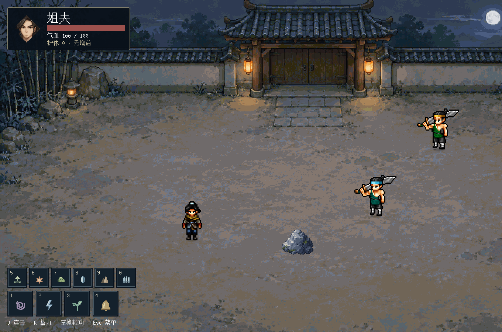
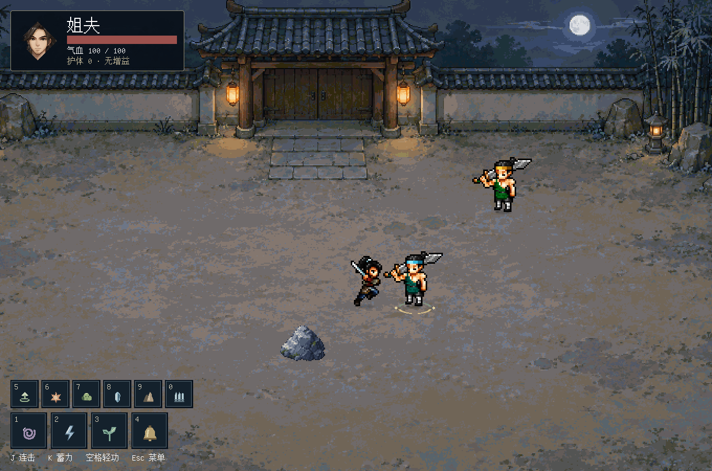
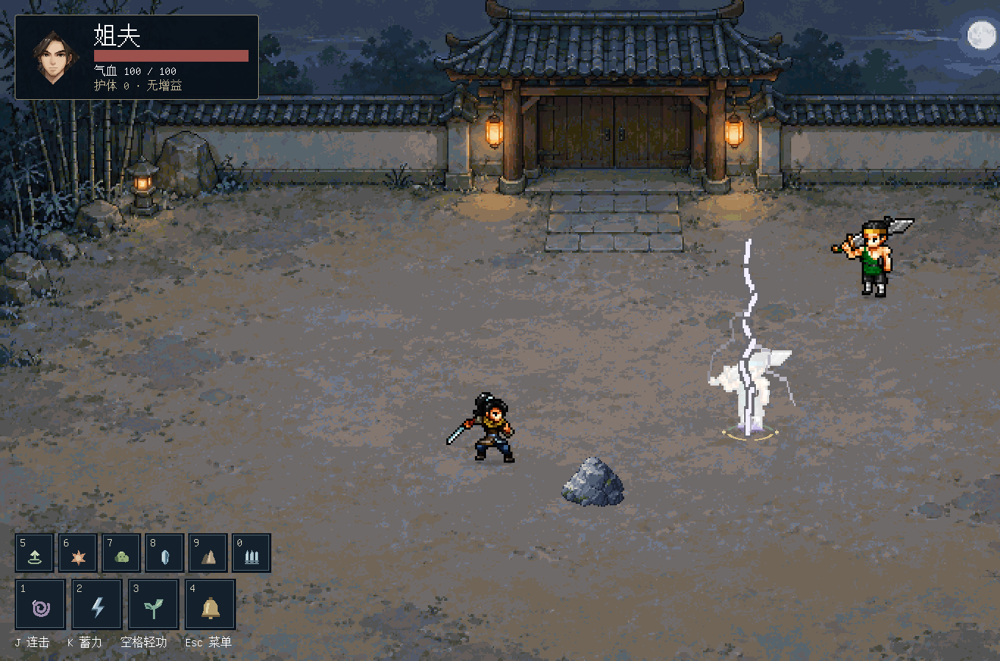
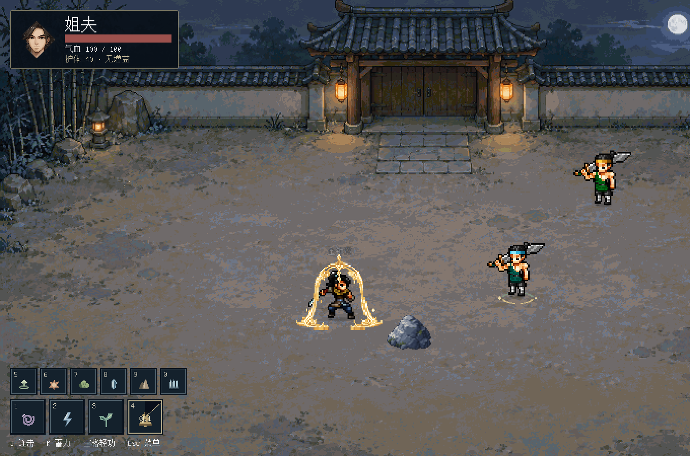
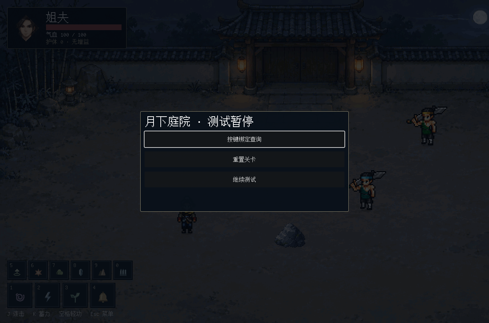
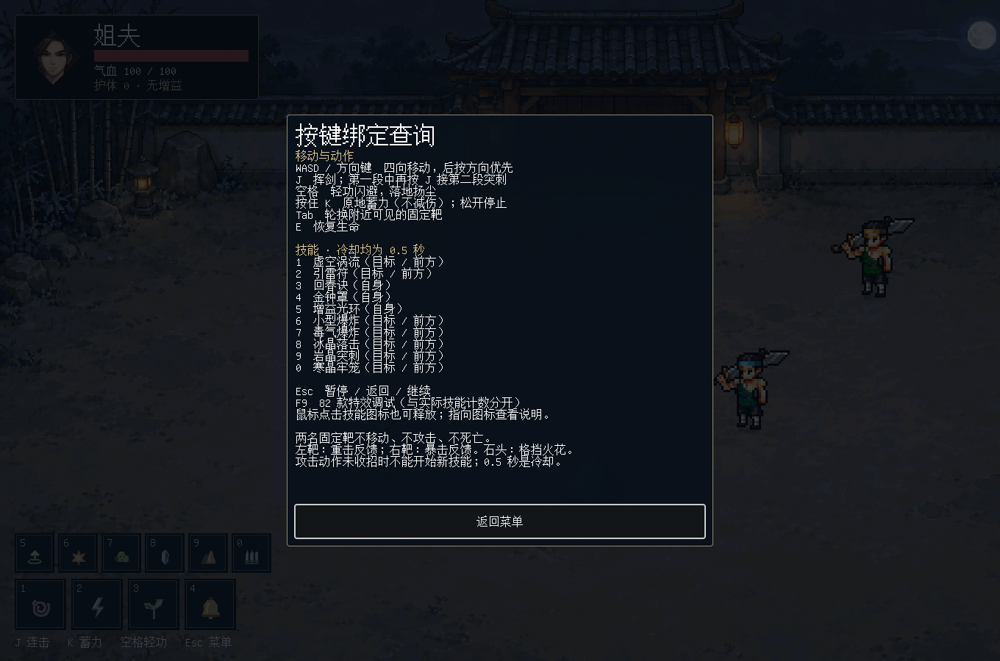
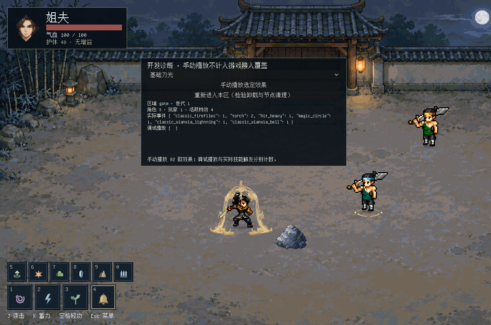

# Jeff FX 1.0.1 · 庭院测试与技能接入说明

[返回 README](../README.md) · [插件图文手册](manual.md) · [素材许可](../NOTICE.md)

这是纯 2D 特效接入示例，使用当前月下庭院和角色“姐夫”。只有一个正常测试入口，不包含旧山门和旧六场景副本。

## 第 1 步：下载并运行完整工程

从仓库选择 **Code → Download ZIP** 并解压，或克隆仓库。在 Godot 项目管理器点击“导入”，选择解压后根目录的 **project.godot**。等待首次图片、字体和插件导入完成，按 **F5**。

主场景为 `scenes/moon_temple/main.tscn`；打开它后按 F6 也可运行。`basic_courtyard.tscn` 只保存布局，不是完整游戏入口。若只下载了 Release 的插件 ZIP，需要另行下载仓库源码才能运行庭院。

## 第 2 步：熟悉移动、普攻和练功靶

用 WASD 或方向键移动；同时按两个方向时以后按方向为准。靠近靶子，朝向它按 J。第一段中再按一次 J，会接第二段突刺。

第一段挥剑图像来自角色动作本身；第二段叠加插件的“突刺”。攻击实际命中后才出现受击反馈，空挥不会让靶子闪白。左侧蓝头巾靶播放重击、右侧绿头巾靶播放暴击；两名靶子都不会死亡。站到练功石旁朝它挥剑，可以看到格挡火花。

按空格沿移动方向使用轻功，未移动时沿当前朝向。疾步残风留在实际经过的地面，落地播放轻功踩踏。角色影子留在地面并随起落调整。按住 K 进入蓄力，松开结束；K 不提供格挡或减伤。Tab 在附近可见靶之间切换，锁定提示位于脚下。

## 第 3 步：按键释放十个技能

左下方大框对应 1–4，上方小框对应 5–0。鼠标单击图标也能释放。冷却用顺时针遮罩显示，均为 **0.5 秒**；当前动作尚未收招时，新请求不会开始。接受释放后，技能名在头顶短暂显示。

| 按键 | 技能 | 位置/对象 | 效果 ID |
|---|---|---|---|
| 1 | 虚空涡流 | 目标脚下或前方地面 | `classic_magic_voidvortex` |
| 2 | 引雷符 | 目标位置预警后落雷 | `magic_circle` + `classic_xianxia_lightning` |
| 3 | 回春诀 | 自身恢复生命 | `classic_magic_heal` + `heal` |
| 4 | 金钟罩 | 护体跟随自身，持续 4 秒 | `classic_xianxia_bell` |
| 5 | 增益光环 | 脚下光环跟随，持续 6 秒 | `buff_aura` |
| 6 | 小型爆炸 | 目标躯干 | `explosion_small` |
| 7 | 毒气爆炸 | 目标躯干 | `explosion_poison` |
| 8 | 冰晶落击 | 目标区域 | `classic_magic_icefall` |
| 9 | 岩晶突刺 | 目标地面 | `classic_magic_earth` |
| 0 | 寒晶牢笼 | 目标区域 | `classic_magic_icecage` |

引雷符在雷电动画第 12 张画面（索引 11）落下时产生一次受击。其他技能也能让靶子播放受击动作及闪白，但不叠加普攻专用的受击/重击/暴击效果。技能准备阶段不额外给施法者添加通用特效；治疗、护体和增益自身效果照常显示。

## 第 4 步：查询按键、暂停和重置

按 Esc 暂停。点击 **按键绑定查询** 查看所有操作；点击 **重置关卡** 清除当前技能、状态和效果，恢复主角与固定靶。重置不修改你保存的插件配方。

E 恢复主角生命。当前固定靶不攻击，因此正常测试不会造成主角死亡；这是表现测试场，不是完整关卡或伤害平衡样本。

## 第 5 步：浏览其余效果

按 F9 打开效果浏览面板，下拉选择一个效果，点击 **手动播放选定效果**。再次按 F9 收起。此入口可查看全部 82 款已导出的动画，默认不接入命中逻辑，调试次数与游戏触发次数分别记录。

需要调整原始配方、重新录制镜头或导出不同尺寸时，停止游戏，打开编辑器顶部 Jeff FX；具体操作见 [插件图文手册](manual.md)。

## 第 6 步：调整测试技能，保留原库

在 Godot 文件系统找到 `data/moon_temple/`，单击技能 `.tres`，在检查器修改参数。当前顺序固定为：`void`、`thunder`、`heal`、`bell`、`buff`、`explosion`、`poison`、`icefall`、`earth`、`icecage`，分别对应 1–0。

| 参数 | 含义与注意事项 |
|---|---|
| `title` | 头顶技能名与菜单名称 |
| `cooldown` | 释放标记触发后的冷却秒数 |
| `effect_id` | `data/effects.json` 中的效果 ID；替换成适合当前目标方式的效果 |
| `animation` / `release_frame` | 角色动作与释放帧；-1 使用动作表默认标记 |
| `target_mode` | 自身或目标区域；不能只改这一项就增加新游戏逻辑 |
| `effect_scale` / `display_offset` | 此技能实例的大小和偏移，不改原库 |
| `radius` / `damage` | 游戏侧判定半径和伤害；固定靶保留满血 |
| `duration` | 展示或状态持续时间；护体、增益由游戏脚本管理 |
| `impact_frame` | 引雷符的受击帧；与导出动画对应，不是按键时间 |

测试中的按键来自 `scripts/moon_temple/game.gd` 的 `SKILL_KEYS` 与动作输入处理；HUD 标签在 `test_hud.gd`。修改按键时同时更新标签和帮助文字。这是游戏脚本配置，不是插件的图形化技能绑定面板，不会改写项目 InputMap。

受击三种场景变体分别存于 `data/courtyard/fx_variants/`，对应帧图在 `assets/courtyard/fx_variants/`。原库配方在 `addons/fx_forge/`，二者隔离。改变测试变体 `.tres` 后还要重新导出帧图并同步 `manifest.json`，不会自动改变已经烘焙的 PNG。建议先在插件“另存为”一份新配方，再导出到自己的测试目录。

轻功尺寸、地面深度和播放速度由 `data/courtyard/dash_settings.tres` 调整；普攻范围由 `data/courtyard/combat_settings.tres` 调整。修改后重新运行观察四个方向，不要直接改动插件预设来适配单个角色。

## 效果如何进入游戏

| 类型 | 当前庭院中的事件 | 接入方式 |
|---|---|---|
| 动作反馈 | 跑步、轻功起步/路径/落地、K 蓄力 | 脚底或身体锚点；跟随与地面残留分开 |
| 普攻反馈 | J 第一段和第二段实际命中 | 左靶重击、右靶暴击，只有命中才触发 |
| 场景交互 | J 命中练功石 | 石头接触点生成格挡火花 |
| 主动技能 | 1–0 | 动作释放标记触发，目标/自身/地面分别处理 |
| 持续状态 | 金钟罩、增益 | 跟随主角，状态结束后消散 |
| 预警 | 引雷符落下前 | 地面法阵先出现，落雷帧再结算 |
| 手动浏览 | F9 的其余效果 | 仅预览，不计入实际技能覆盖 |

`game.gd` 管输入、技能与判定；`actor.gd` 管角色动作、脚底锚点和受击；`fx_service.gd` 按效果 ID 创建动画并负责区域内清理；`effect.gd` 管帧播放、跟随与消散。`data/effects.json` 保存已导出帧的区域、时长和锚点。这里的经典库效果已录制为二维帧，不能在游戏中重新转动三维镜头。

## 使用范围与排错

- 看不到插件：等待导入完成，再到项目设置启用 Jeff FX。
- F5 无法运行：检查是否下载了完整源码，根目录应有 `project.godot`、`assets/`、`data/`、`scenes/`、`scripts/`。
- 技能没反应：先确认 Esc 菜单关闭、当前动作收招、冷却结束；点击游戏窗口获得输入焦点。
- 修改配方后游戏没变：游戏播放导出的 PNG；修改后需要重新导出并更新对应动画数据。
- 本示例有测试用途的固定靶和宽松判定，不提供完整敌人 AI、装备系统或生产环境性能保证。
- 角色与头像是第三方素材，使用范围请看 [素材说明](../NOTICE.md)，不要将它们视作 CC0 资源。
